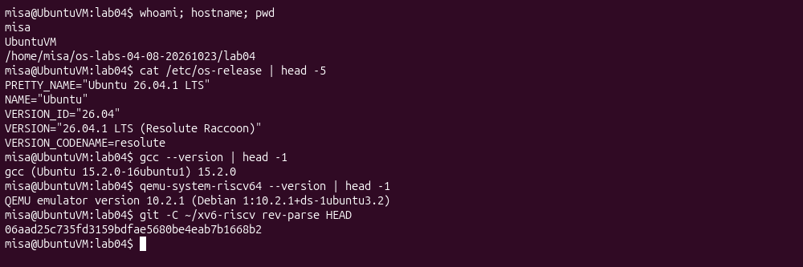
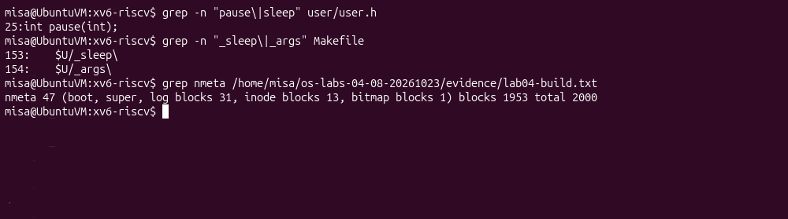
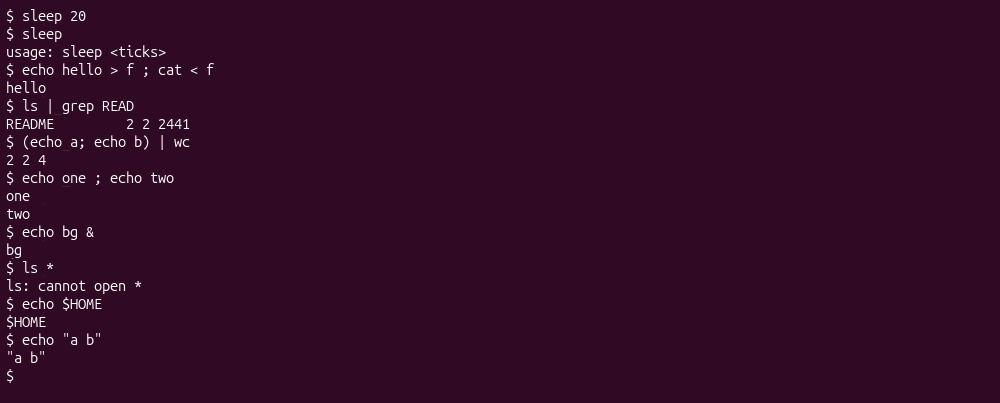
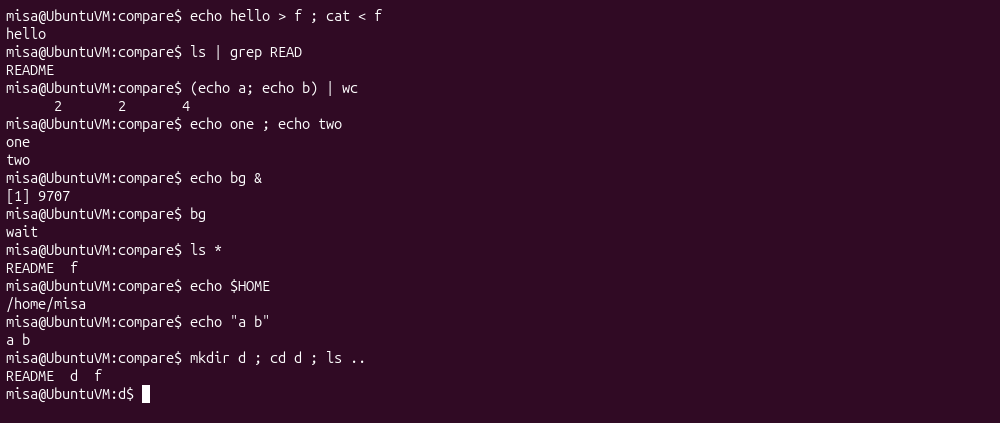
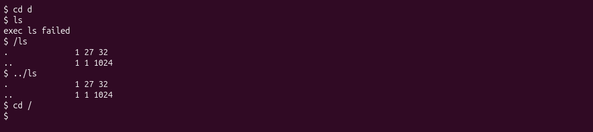
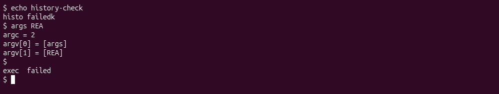
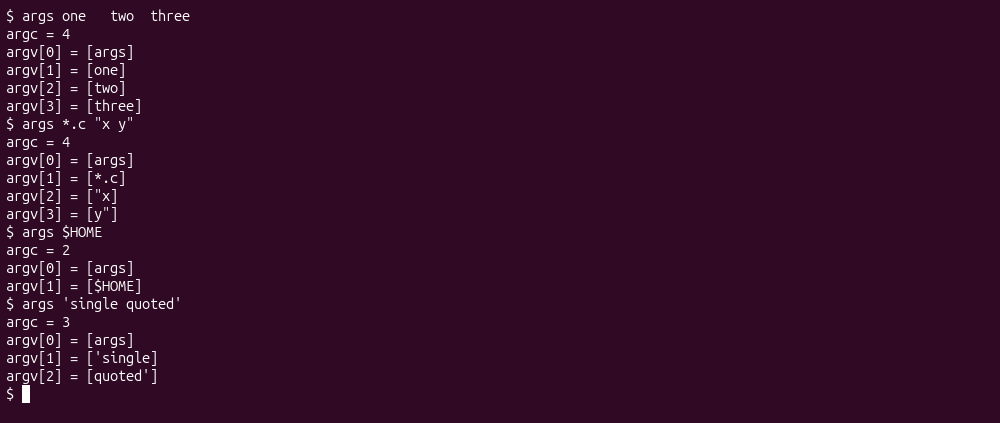
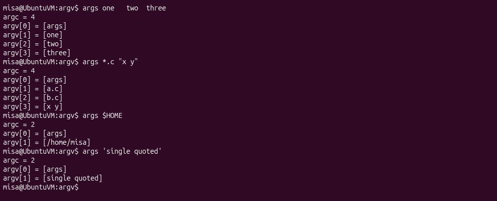
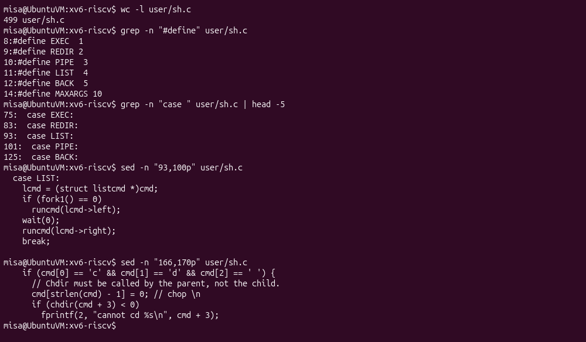

# Lab 04 - The xv6 Shell from the Outside

## Environment

All experiments were performed on 23 October 2026 inside **Ubuntu 26.04.1 LTS (ARM64)** running in VirtualBox as user `misa` on `UbuntuVM`. The Linux kernel is `7.0.0-38-generic`. The installed xv6 checkout is `~/xv6-riscv`, commit `06aad25c735fd3159bdfae5680be4eab7b1668b2`. GCC and the RISC-V compiler are version 15.2.0; QEMU is version 10.2.1. xv6 is booted from this Ubuntu with `make qemu CPUS=1`.

The figures are screenshots of the Ubuntu terminal during execution. Complete command output is provided in `terminal-output.txt`; build logs are in `build-output.txt` for the xv6 labs. PIDs, inode numbers and free-space values below refer to these recorded runs.




## Part 1 - Sleep on the installed xv6

`user/user.h` declares `pause(int)`, so `user/sleep.c` calls `pause(atoi(argv[1]))`. The command remains named `sleep`, and its argument is a number of timer ticks. Exactly one argument is required; otherwise it prints usage and exits with status 1. The Makefile has entries for both `sleep` and `args` in `UPROGS`.




```text
$ sleep 20
$ sleep
usage: sleep <ticks>
```

`sleep 20` returned to the shell after its pause; `sleep` without an argument printed the expected usage message. The same compiled utility is used in the subsequent xv6 experiments.

## Part 2 - Bash versus the xv6 shell

The Bash comparison was performed in a new directory containing `README`. xv6 used a freshly built image with the lab utilities. The complete comparison is:

| Command or feature | Bash | xv6 |
| --- | --- | --- |
| `echo hello > f ; cat < f` | Prints `hello`. | Prints `hello`; redirection and ordered lists work. |
| `ls \| grep READ` | Prints `README`. | Prints the README row with type, inode and byte size. |
| `(echo a; echo b) \| wc` | `2 2 4` | `2 2 4` |
| `echo one ; echo two` | Prints `one`, then `two`. | Same order. |
| `echo bg &` | Runs in the background and displays job/PID information. | Runs in the background without Bash's job table. |
| `ls *` | Expands the existing names `README` and `f`. | `ls: cannot open *`; the asterisk is literal. |
| `echo $HOME` | `/home/misa` | Literal `$HOME`. |
| `echo "a b"` | `a b` | `"a b"`, with the quotes retained. |
| `mkdir d ; cd d ; ls ..` | Enters `d` and lists its parent. | `exec cd failed`; the shell stays in the root directory. |
| Up, Tab, Ctrl+R | History, completion and reverse search work. | These interactive facilities are absent. |








### 1. Features common to both shells and features added by Bash

Both support running executables, input/output redirection, pipes, semicolon-separated lists, background commands and parenthesized grouping. Bash additionally provides wildcard and variable expansion, quote processing, PATH search, richer built-ins, command history, completion and job management.

The xv6 LIST case explicitly forks the left command, calls `wait(0)`, and then runs the right command. Therefore `echo hello > f ; cat < f` is ordered and reads the newly written file; it is not a race between the two commands.

### 2. Why ls fails after cd, and how to run it

A standalone `cd d` changes the parent shell's working directory. xv6 does not search PATH; bare `ls` is interpreted as an executable relative to the current directory, while the program is stored in `/`. Use `/ls` or `../ls` from `d`.




In `mkdir d ; cd d ; ls ..`, the special parent-shell check does not see `cd` at the start of the line. The list parser treats it as a separate executable, which does not exist, producing `exec cd failed`. Even a real external cd could change only its own working directory, not that of the parent shell.

### 3. Which missing feature I would add

Executable search would matter most in daily use because changing directory otherwise breaks short program names. A simple fallback that tries `/command` after a failed relative exec would be the easiest useful first extension. Full Bash-compatible expansion and quoting require more parsing and expansion logic.

### Interactive key checks

In Bash, Up recalled `echo history-check`, Tab completed `cat REA` to `cat README`, and Ctrl+R found the earlier command. The screenshot captures the active reverse-search match. In xv6, Up did not recall the previous command, Tab acted as whitespace rather than filename completion, and Ctrl+R did not initiate history search.





## Part 3 - A program that prints argv

`user/args.c` prints argc and every argument using xv6 headers and exits with `exit(0)`. `args_linux.c` uses `<stdio.h>` and returns 0. The Linux program was compiled with `gcc -Wall -Wextra -Werror -o args args_linux.c`. A separate Bash directory contained exactly `a.c` and `b.c`; the directory holding `args` was added to PATH.







### 1. Outputs for args *.c "x y"

Ubuntu Bash:

```text
$ args *.c "x y"
argc = 4
argv[0] = [args]
argv[1] = [a.c]
argv[2] = [b.c]
argv[3] = [x y]
```

xv6:

```text
$ args *.c "x y"
argc = 4
argv[0] = [args]
argv[1] = [*.c]
argv[2] = ["x]
argv[3] = [y"]
```


Both have argc 4, including argv[0]. Bash passes three user arguments: `a.c`, `b.c`, and the single string `x y`. xv6 passes the literal `*.c` and the two strings `"x` and `y"`. Equal counts are coincidental: changing the number of matching C files changes Bash's argc.

### 2. Who expands the wildcard and removes quotes?

The shell performs both transformations before exec. The kernel accepts an executable pathname and an already constructed argument vector; the argument-printing program only displays what it receives. Bash also replaces `$HOME` with `/home/misa` and turns `'single quoted'` into one argument without the quote characters. xv6 passes `$HOME` literally and splits the quoted phrase into two strings retaining the quote characters.

### 3. What happened to repeated spaces?

For `args one   two  three`, both systems report argc 4 and arguments `one`, `two`, `three`. Runs of unquoted whitespace separate words and do not create empty arguments. Bash can preserve spaces using quotes; the xv6 tokenizer does not implement that quoting rule.

## Part 4 - Read user/sh.c

The installed source has 499 lines. Its five command kinds and execution cases were inspected directly in Ubuntu:




### 1. Five command kinds and their syntax

| Kind | Syntax | Execution |
| --- | --- | --- |
| EXEC | A program name and arguments | `exec(argv[0], argv)` replaces the child image. |
| REDIR | `<`, `>`, `>>` | Redirects a descriptor before executing the nested command. |
| PIPE | `\|` | Connects two children through a pipe and waits for both. |
| LIST | `;` | Waits for the left command before running the right one. |
| BACK | `&` | Forks a command without waiting for its completion in that branch. |

Parentheses group commands rather than defining a sixth kind. In this source, the execution cases begin at lines 75, 83, 93, 101 and 125 respectively.

### 2. Where cd is handled and why

In `main`, line 166 checks for a line beginning with `cd ` and line 169 calls `chdir(cmd + 3)` before the shell forks a command. The shell itself must make the call because the current working directory is a per-process property.

### 3. Why there is no wildcard or variable expansion

Literal searches for `*` and `$` were run on `user/sh.c`. Asterisks occur in pointer declarations and dereferences; `$` occurs in the prompt. No expansion routine resolves filenames or environment variables. The tokenizer splits words using whitespace and syntax symbols such as `<`, `>`, `|`, `&`, `;` and parentheses. This explains the literal asterisk, variable name and quote characters observed above.

## Submission checklist

`user/sleep.c`, `user/args.c`, `args_linux.c`, the complete xv6 `Makefile`, and this `notes.md` are included. The terminal transcripts and build output are from UbuntuVM. The report directory contains the LaTeX sources, screenshots and compiled PDF.
