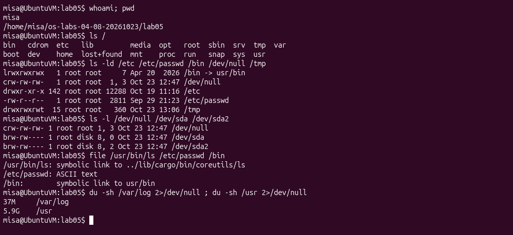
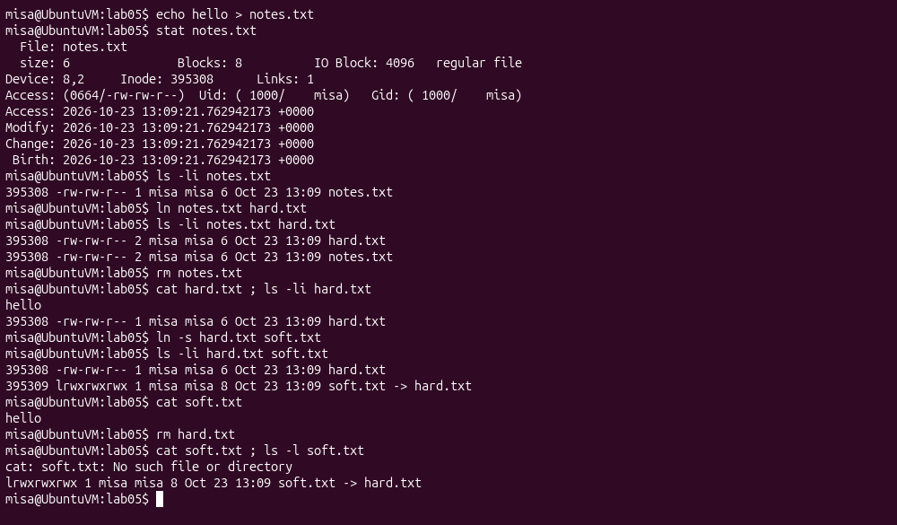
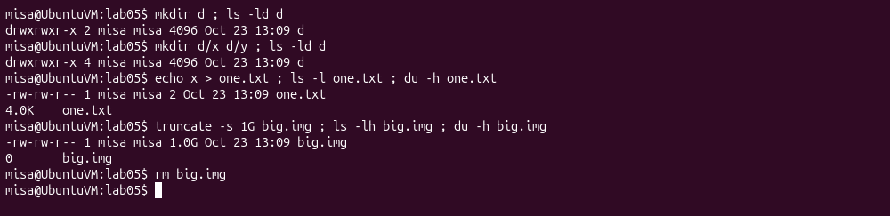
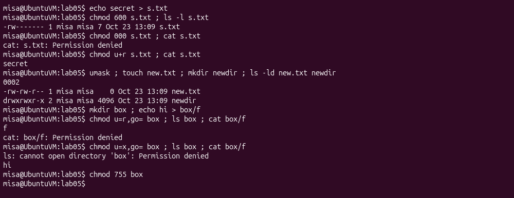
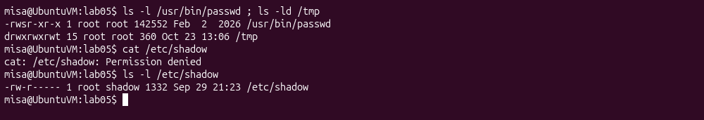
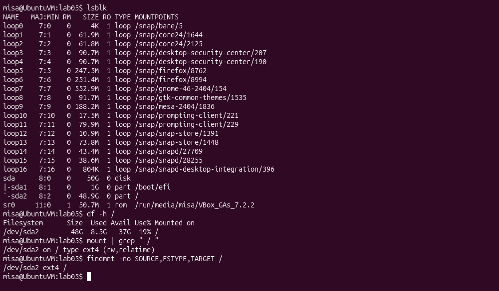
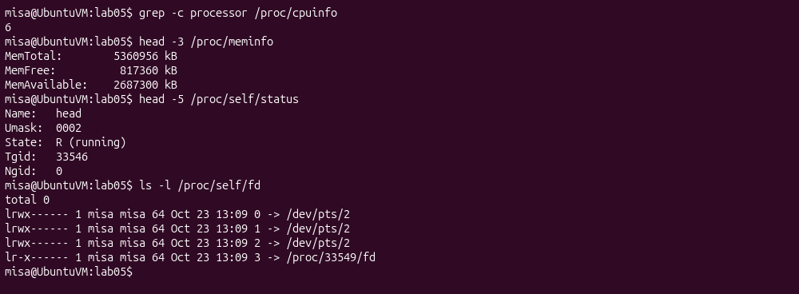
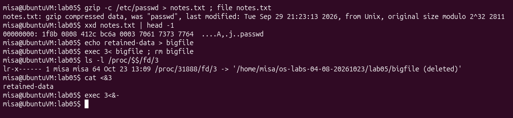

# Lab 05 - The File System with Your Own Hands

## Environment

The experiments were performed inside Ubuntu 26.04.1 LTS (ARM64) in VirtualBox on 23 October 2026. The user was `misa`, not root. All experiment files were created in `~/os-labs-04-08-20261023/lab05`, on Ubuntu's ext4 filesystem. The measured umask was `0002`. The figures show the actual Ubuntu terminal; `terminal-output.txt` contains the full command output.

## Part 1 - The tree and file types





### 1. Types from the first character of ls -l

| Path | First character | Type |
| --- | --- | --- |
| `/etc` | `d` | Directory containing system configuration. |
| `/etc/passwd` | `-` | Regular file containing account metadata. |
| `/bin` | `l` | Symbolic link to `usr/bin`. |
| `/dev/null` | `c` | Character device. |
| `/tmp` | `d` | Temporary directory with a sticky bit. |

The type character is separate from the following nine permission bits. In this Ubuntu installation, `file /usr/bin/ls` also reports a symbolic link, to `../lib/cargo/bin/coreutils/ls`. Following it with `file -L /usr/bin/ls` identifies an ARM aarch64 ELF executable. `file /etc/passwd` reports ASCII text.

### 2. What /bin is and where it points

`/bin` is a symbolic link containing the relative target `usr/bin`. Because its parent is `/`, that resolves to `/usr/bin`. It is part of this installation's merged-/usr layout.

### 3. One character device and one block device


```text
$ ls -l /dev/null /dev/sda /dev/sda2
crw-rw-rw- 1 root root 1, 3 Oct 23 12:47 /dev/null
brw-rw---- 1 root disk 8, 0 Oct 23 12:47 /dev/sda
brw-rw---- 1 root disk 8, 2 Oct 23 12:47 /dev/sda2
```


`/dev/null` is a character device (major 1, minor 3). `/dev/sda` is a block device (major 8, minor 0), and `/dev/sda2` is its second partition (major 8, minor 2). These are actual device nodes visible inside Ubuntu. Reads from `/dev/null` return EOF and writes are discarded; the disk is accessed in blocks.

### 4. Which directory is larger?


```text
$ du -sh /var/log 2>/dev/null ; du -sh /usr 2>/dev/null
37M	/var/log
5.9G	/usr
```


`/usr` occupies about 5.9 GiB versus 37 MiB for `/var/log`: roughly 5.86 GiB more, or about 160 times as much, based on the rounded output. `du` measures allocated storage; unreadable-path diagnostics were suppressed as required.

## Part 2 - Inodes and links

### 1. Inode number and count of names

`echo hello > notes.txt` created a six-byte file, including the newline. `stat` reported inode **395308**, **Links: 1**, size 6 and 8 allocated accounting blocks. The initial mode was 0664 under umask 0002. An inode identifies the object within its filesystem; a directory entry associates a name with that inode.




### 2. Why hard.txt survived rm notes.txt


```text
$ ln notes.txt hard.txt
$ ls -li notes.txt hard.txt
395308 -rw-rw-r-- 2 misa misa 6 Oct 23 13:09 hard.txt
395308 -rw-rw-r-- 2 misa misa 6 Oct 23 13:09 notes.txt
$ rm notes.txt
$ cat hard.txt ; ls -li hard.txt
hello
395308 -rw-rw-r-- 1 misa misa 6 Oct 23 13:09 hard.txt
```


Both names referred to inode 395308. Creating the second name raised its link count to 2 without copying the contents. `rm` removes a directory entry and decreases the count; it does not treat the first-created name as special. After removing `notes.txt`, the remaining name still opened the same six-byte object with link count 1. Storage can be reclaimed after both the final hard link and final open reference disappear.

### 3. Why the symlink became unreadable, and its size

`soft.txt` had its own inode, 395309, and stored the pathname `hard.txt`. It initially resolved to the readable target. After `rm hard.txt`, `cat soft.txt` failed with `No such file or directory`, although `ls -l soft.txt` still displayed the symlink.

The symlink's logical size was exactly **8 bytes**, the length of `hard.txt`, without a terminating NUL or newline. It stores a pathname, not a hard-link reference that keeps the target inode alive.

### 4. Directory link counts

The prediction was 2 links for a new directory and 4 after creating two immediate subdirectories. The actual `ls -ld d` outputs confirmed both values.

The parent entry naming `d` and `d/.` account for its first two links. `d/x/..` and `d/y/..` each add one link back to `d`. The entry `d/..` points to d's parent and therefore does not add a link to d itself.




### 5. Why two bytes use 4 KiB, but a 1 GiB file uses zero data blocks

`echo x > one.txt` wrote `x` plus a newline: size 2 bytes, but `du -h one.txt` reported 4.0K. This ext4 filesystem allocates data in blocks, so the small file uses one 4 KiB block (8 accounting units of 512 bytes).

`truncate -s 1G big.img` produced a logical length of 1,073,741,824 bytes, while `du -h big.img` reported 0. It is a sparse file whose holes read as zeros without allocated data blocks. Its inode and other metadata still require storage. The temporary image was removed after the check.

## Part 3 - Permissions

### 1. Modes and uses

| Mode | Permission string | Example use |
| --- | --- | --- |
| `600` | `rw-------` | A private data file or SSH private key. |
| `644` | `rw-r--r--` | A public document writable only by its owner. |
| `755` | `rwxr-xr-x` | A shared directory or executable. |
| `700` | `rwx------` | A private directory or personal executable. |

The owner, group and others each use read=4, write=2 and execute/search=1. The separate type character is not part of the numeric permission mode.

### 2. Why owning a mode-000 file does not make it readable

`chmod 000 s.txt ; cat s.txt` returned `Permission denied`. As the owner, `misa` is checked against the owner permission class, which had no read bit. Ownership permits changing the mode with chmod, rather than automatically bypassing data access checks. After `chmod u+r s.txt`, cat printed `secret`.




### 3. Umask and permissions of newly created objects


```text
$ umask ; touch new.txt ; mkdir newdir ; ls -ld new.txt newdir
0002
-rw-rw-r-- 1 misa misa    0 Oct 23 13:09 new.txt
drwxrwxr-x 2 misa misa 4096 Oct 23 13:09 newdir
```


The measured mask is **0002**. Ordinary files begin with requested mode 0666, giving `0666 & ~0002 = 0664` (`rw-rw-r--`). Directories begin with 0777, giving `0777 & ~0002 = 0775` (`rwxrwxr-x`). Umask removes requested bits and does not add execute permission to a new text file.

### 4. Directory r versus x

Prediction for read-only: list names, but fail to open a known file. Prediction for execute-only: fail to list names, but allow access to a known file if that file is readable. The results matched:

- With `chmod u=r,go= box`, `ls box` printed `f`, but `cat box/f` was denied.
- With `chmod u=x,go= box`, `ls box` was denied, but `cat box/f` printed `hi`.

Directory read permission allows reading the list of names. Execute/search permission allows resolving a known entry and traversing the directory. Opening a file requires search permission through its parent directories and the file's own read permission. Directory write together with search controls creating/removing names. The mode was restored to 755 after the test.

### 5. Meaning of s and t





`/usr/bin/passwd` displayed `-rwsr-xr-x`: `s` in the owner position denotes setuid plus execute. When executed with the normal privilege rules, its effective UID becomes that of its owner, root, allowing controlled updates to protected password data after authentication checks.

`/tmp` displayed `drwxrwxrwt`: the sticky `t` restricts removal and renaming of other users' entries in this shared writable directory. It does not itself prevent reading a readable file. `/etc/shadow` was owned by root and group shadow with mode 0640; `cat /etc/shadow` as `misa` correctly returned `Permission denied`.

## Part 4 - Disks and the kernel as files

### 1. Disk, partitions, root mount and filesystem type





```diagram
sda: 50 GiB virtual disk
  sda1: 1 GiB, vfat, mounted at /boot/efi
  sda2: 48.9 GiB, ext4, mounted at /
sr0: VirtualBox Guest Additions optical disc
loop0 ... loop16: read-only Snap application images
```

`lsblk` gives the disk/partition tree. `mount | grep " / "` printed `/dev/sda2 on / type ext4 (rw,relatime)`, confirmed by findmnt. The EFI filesystem type was also checked with `findmnt -no SOURCE,FSTYPE,TARGET /boot/efi`, which reported `/dev/sda1 vfat /boot/efi`.

### 2. How full is the root filesystem?


```text
$ df -h /
Filesystem      Size  Used Avail Use% Mounted on
/dev/sda2        48G  8.5G   37G  19% /
```


The root filesystem reported **48G total, 8.5G used, 37G available and 19% usage**. These are rounded filesystem figures, not the raw partition size. Metadata and reserved space help explain why total, used and available values do not add up exactly.

### 3. CPU count and RAM according to /proc





```text
$ grep -c processor /proc/cpuinfo
6
$ head -3 /proc/meminfo
MemTotal:        5360956 kB
MemFree:          817360 kB
MemAvailable:    2687300 kB
```


There are **6 visible logical CPUs**; this command does not establish a count of physical cores in the host computer. MemTotal is **5,360,956 KiB**, about **5.11 GiB**, as visible to this Ubuntu VM. MemAvailable estimates readily usable memory including reclaimable cache, while MemFree counts completely unused memory.

### 4. Which program appears in /proc/self/status, and why?

The Name field was **head**. `/proc/self` refers to the process accessing that path, so `head -5 /proc/self/status` reads head's own status, rather than the shell's. In `ls -l /proc/self/fd`, self instead denotes ls, and the extra directory descriptor belongs to that process's listing operation. These files expose live kernel information.

## Stretch A - Magic numbers





`gzip -c /etc/passwd > notes.txt` produced a gzip stream despite the `.txt` extension. `file notes.txt` recognized gzip data; xxd began with `1f8b 0808`. Bytes **1f 8b** are the gzip signature, and **08** identifies the deflate compression method. File identification uses content rather than the filename extension.

## Stretch C - Delete a file that is still open

The commands opened `bigfile` on descriptor 3, removed its name, and inspected `/proc/$$/fd/3`. The link ended in **bigfile (deleted)**. `cat <&3` still printed `retained-data`, confirming that the open descriptor retained access after unlink. `exec 3<&-` closed the final reference; with no hard links remaining, storage could then be reclaimed.

## Submission checklist

This `report.md` contains all Observe answers and both stretch experiments. `terminal-output.txt` preserves the recorded Ubuntu output. `collect.sh` repeats the filesystem experiments as an ordinary user in a fresh temporary directory. The report directory contains the LaTeX report, actual terminal screenshots and compiled PDF.
