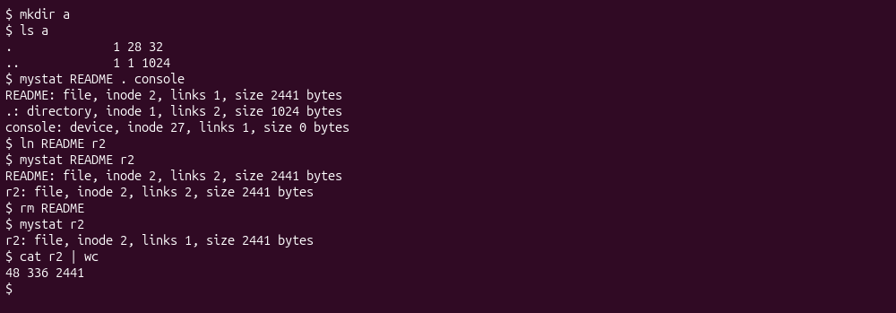
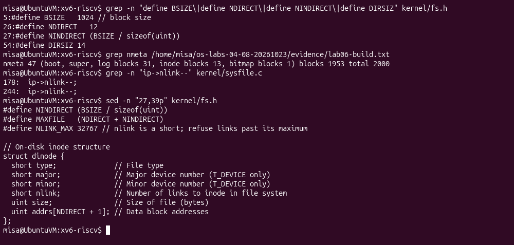
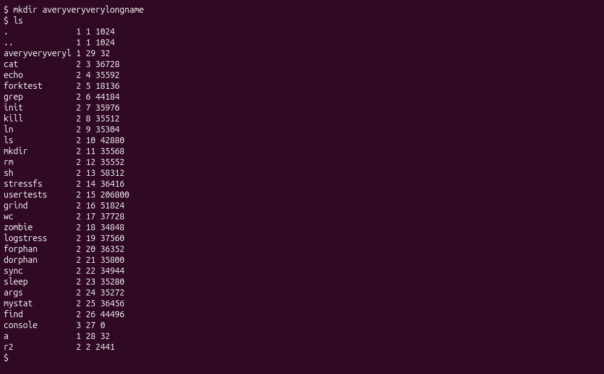
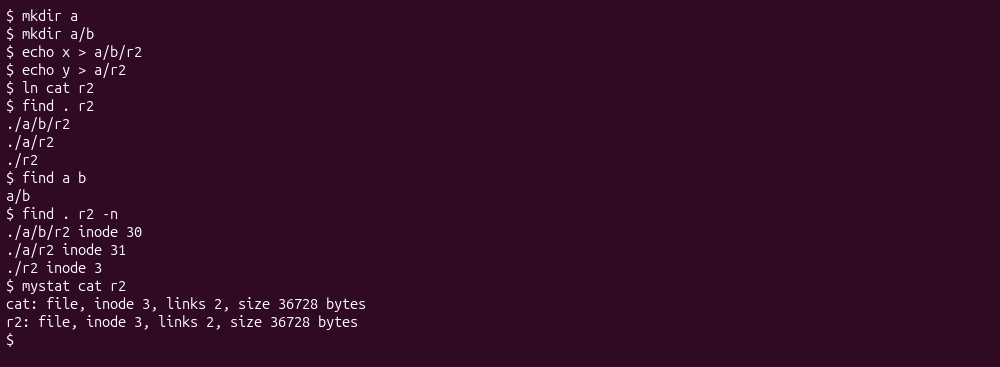
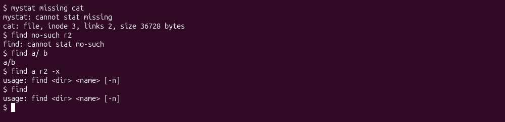

# Lab 06 - Inside the xv6 File System

## Environment

All experiments were performed on 23 October 2026 inside **Ubuntu 26.04.1 LTS (ARM64)** running in VirtualBox as user `misa` on `UbuntuVM`. The Linux kernel is `7.0.0-38-generic`. The installed xv6 checkout is `~/xv6-riscv`, commit `06aad25c735fd3159bdfae5680be4eab7b1668b2`. GCC and the RISC-V compiler are version 15.2.0; QEMU is version 10.2.1. xv6 is booted from this Ubuntu with `make qemu CPUS=1`.

The figures are screenshots of the Ubuntu terminal during execution. Complete command output is provided in `terminal-output.txt`; build logs are in `build-output.txt` for the xv6 labs. PIDs, inode numbers and free-space values below refer to these recorded runs.

This laboratory used its own freshly built xv6 image. The image was rebuilt again before the required nested-find test, so that its setup started without the earlier hard-link experiment. The lab 06 Makefile retains `sleep` and `args` and adds `mystat` and `find`.

## Part 1 - Read what xv6 shows

xv6 ls prints four fields: name, numeric type, inode number and logical size in bytes. It does not print Unix permission bits or ownership fields like Linux ls -l.

### 1. Meaning of types 1, 2 and 3

`kernel/stat.h` defines **T_DIR = 1** (directory), **T_FILE = 2** (regular file) and **T_DEVICE = 3** (device). The console is a device inode connected to a driver rather than ordinary file data.

### 2. Root inode and the dot entries

The root inode is **1**, specified by `ROOTINO` in `kernel/fs.h`. Both `.` and `..` in the root name inode 1 because the root is its own parent. The root directory's logical size in this image is 1024 bytes.

### 3. Empty-directory size

After `mkdir a`, ls a showed only `.` and `..` and a size of **32 bytes**. `struct dirent` contains a two-byte inode number and a fourteen-byte name, making each entry **16 bytes**. Therefore two entries occupy 32 logical bytes, although their storage is allocated in whole blocks. An exactly fourteen-byte name need not be NUL-terminated on disk.




## Part 2 - mystat

`user/mystat.c` accepts one or more paths, calls stat for each, maps numeric types to readable strings and prints the inode number, link count and size. An invalid path reports an error on descriptor 2 and does not suppress later valid paths. Usage/stat errors cause a nonzero exit status.

### 1. Outputs after ln and after rm


```text
$ mystat README . console
README: file, inode 2, links 1, size 2441 bytes
.: directory, inode 1, links 2, size 1024 bytes
console: device, inode 27, links 1, size 0 bytes
$ ln README r2
$ mystat README r2
README: file, inode 2, links 2, size 2441 bytes
r2: file, inode 2, links 2, size 2441 bytes
$ rm README
$ mystat r2
r2: file, inode 2, links 1, size 2441 bytes
$ cat r2 | wc
48 336 2441
```


Initially README had inode 2, one link and size 2441. `ln README r2` created a second name for that same inode and raised both reported link counts to 2. Removing README left r2 with inode 2, the same size and contents, and one remaining link. `cat r2 | wc` confirmed that the file remained readable.

The root's link count was 2 at the stat check because directory a had already been created. xv6's initial directory link accounting does not count `.` in the same way as Linux's usual new-directory convention; its initial root count is 1.

### 2. Where unlink decreases the count and when blocks are freed

`kernel/sysfile.c:244` in the installed checkout contains `ip->nlink--;` inside `sys_unlink`, followed by `iupdate(ip)` and `iunlockput(ip)`. The earlier matching decrement in sys_link is error rollback, not the normal unlink path.

`sys_unlink` clears the directory slot and decreases the inode's link count. In `kernel/fs.c`, iput detects the last in-memory reference to an unlinked inode (`ref == 1`, valid inode, nlink 0). It calls itrunc to release the direct/indirect data blocks and later makes the inode reusable. An open file holds an additional reference, delaying reclamation until it is closed or the process exits. These updates occur within filesystem transactions.

### 3. Fields of struct dinode

The on-disk inode has `type`, `major`, `minor`, `nlink`, `size`, and `addrs[NDIRECT + 1]`. The first four fields are short integers, size is a uint, and addrs contains thirteen uint block numbers: twelve direct addresses and one indirect address. The structure occupies 64 bytes.

There is no filename, owner UID/GID, permission mode or timestamp. Device inodes use major/minor to select their driver/device. This xv6 baseline has neither symbolic links nor Unix permission checking. The in-memory inode separately stores synchronization and reference-count information.

## Part 3 - Measure the limits





### 1. Long filenames

`mkdir averyveryverylongname` appeared in ls as **averyveryveryl**, the first fourteen characters. The responsible constant is `DIRSIZ = 14`. Distinct long names sharing those initial bytes can resolve to the same directory component; this is a stored-name limit, not display clipping.




### 2. Maximum file size

`BSIZE = 1024`, `NDIRECT = 12`, and `NINDIRECT = BSIZE / sizeof(uint) = 1024 / 4 = 256`. Therefore the maximum content is **(12 + 256) * 1024 = 274432 bytes = 268 KiB**.

The indirect block stores block numbers, so it adds addressing capacity rather than an extra data block in the content calculation. A maximum-size file additionally occupies that indirect metadata block, an inode and other filesystem metadata. Available free space can impose a lower practical limit than this per-file addressing bound.

### 3. Disk layout from the actual nmeta line

The build printed `nmeta 47 (boot, super, log blocks 31, inode blocks 13, bitmap blocks 1) blocks 1953 total 2000`.

| Region | Blocks | Indices |
| --- | --- | --- |
| Boot block and superblock | 2 | 0 and 1 |
| Log header plus 30 payload blocks | 31 | 2 through 32 |
| Inode region | 13 | 33 through 45 |
| Free-block bitmap | 1 | 46 |
| Data region | 1953 | 47 through 1999 |

The total is **2 + 31 + 13 + 1 + 1953 = 2000 blocks**, or 2,048,000 bytes. The 1953-block data region includes already allocated directories and programs; it is not a count of unused blocks.

## Part 4 - Recursive find

`user/find.c` compares each last pathname component with the requested name using strcmp. It handles matching files and directories, skips free slots (`inum == 0`) and never recurses into `.` or `..`. Each on-disk name is copied into a fifteen-byte NUL-terminated buffer before string operations. Path construction is bounded by `MAXPATH`; trailing slashes on the starting path are normalized.

Every directory descriptor is closed before descending into a child. The implementation reopens the parent and skips to its next entry, trading O(n squared) reads per directory for bounded descriptor use. A shared path buffer reduces recursive stack use. This is sufficient for the small teaching filesystem; directories should remain unchanged while it walks them, and path/stack limits still bound the supported depth.

### Fresh-image nested-directory test

A new image was built before this setup:

```text
$ mkdir a/b
$ echo x > a/b/r2
$ echo y > a/r2
$ ln cat r2
$ find . r2
./a/b/r2
./a/r2
./r2
$ find a b
a/b
```


`mkdir a` was also executed at the start of this fresh-image test. The output contains all three r2 paths, and searching for b also finds the directory a/b. The traversal is not restricted to regular files.




### Invalid paths and arguments

The additional checks exercised `mystat missing cat`, `find no-such r2`, `find a/ b`, a bad `-x` option, and missing arguments. mystat continued to print cat after the missing-path error. find reported invalid input explicitly, while the trailing-slash form found the same a/b directory.




## Stretch - Inode numbers next to matches


```text
$ find . r2 -n
./a/b/r2 inode 30
./a/r2 inode 31
./r2 inode 3
$ mystat cat r2
cat: file, inode 3, links 2, size 36728 bytes
r2: file, inode 3, links 2, size 36728 bytes
```


Only `./r2` has inode **3**, shared with cat. `./a/b/r2` and `./a/r2` have independent inodes **30** and **31**. Equal names do not imply a shared file; equal inode numbers on the same filesystem do.

## Submission checklist

`user/mystat.c`, `user/find.c`, the complete xv6 `Makefile`, and this `notes.md` are included. find implements the optional `-n` flag. The submitted build log, transcripts and report screenshots were obtained from the installed xv6 running inside UbuntuVM.
