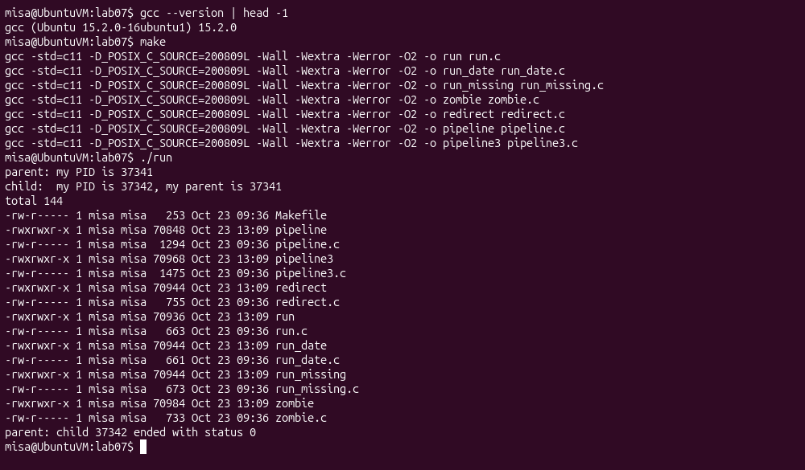
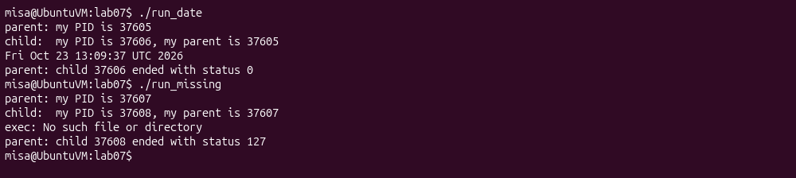
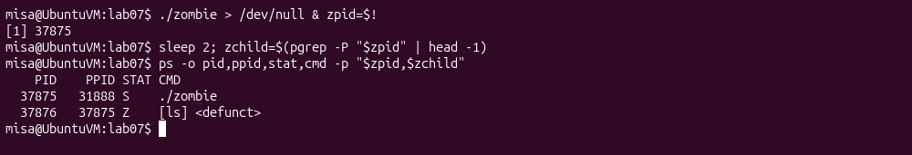
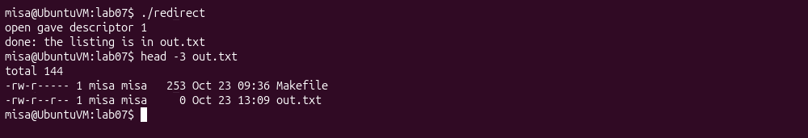
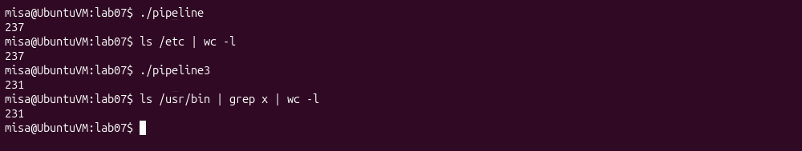
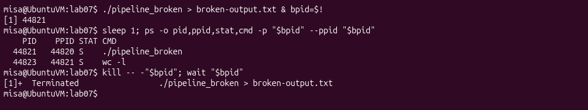

# Lab 07 - Three Small Programs: Processes, Redirection, a Pipe

## Environment

The programs were compiled and executed inside Ubuntu 26.04.1 LTS (ARM64) in VirtualBox as non-root user `misa` on 23 October 2026. The working directory was `~/os-labs-04-08-20261023/lab07`. GCC 15.2.0 compiled all seven programs with C11, `-Wall -Wextra -Werror -O2`. Screenshots and `terminal-output.txt` record the actual runs.

## Part 1 - fork, exec and wait

`run.c` follows the supplied program: the parent prints and flushes its PID, forks, and waits for its child; the child prints its own PID and parent PID and uses execlp to become ls -l. Flushing before fork prevents buffered parent text from being duplicated when output is redirected. The date and nonexistent-program changes are kept as separate sources `run_date.c` and `run_missing.c` so each required case remains runnable.







### 1. Why perror runs only for nosuchprog

Successful execlp replaces the child's process image and does not return to the following line. The same PID now runs ls or date. On failure it returns -1 and sets errno, so `perror("exec")` executes and prints `No such file or directory`. The supplied failure branch then calls `exit(127)`.

### 2. Whose PID appears as my parent?

In the recorded run, the parent PID was **37341**, the child PID was **37342**, and the child printed **37341** as its parent. getpid returns the caller's own PID; getppid returns its current parent's PID. The parent stays alive and waits during this test.

### 3. Statuses for ls and nosuchprog


```text
$ ./run_date
parent: my PID is 37605
child:  my PID is 37606, my parent is 37605
Fri Oct 23 13:09:37 UTC 2026
parent: child 37606 ended with status 0
$ ./run_missing
parent: my PID is 37607
child:  my PID is 37608, my parent is 37607
exec: No such file or directory
parent: child 37608 ended with status 127
```


The parent reported child status **0** for ls/date and **127** for the nonexistent program. Linux waitpid returns an encoded wait status, so WEXITSTATUS extracts the normal exit value. The supplied parent itself returns 0 after printing the child's result, including the failure experiment. A general-purpose shell would additionally check normal versus signal termination before interpreting the status.

## Part 2 - A zombie, on purpose

`zombie.c` is the ls version with `sleep(20)` immediately before waitpid. It was started in the background; after two seconds the process table showed the parent sleeping and the exited child unreaped.




### 1. The STAT letter and its meaning

The ls child PID **37876** had state **Z**, and its command appeared as `[ls] <defunct>`. A zombie has finished executing, but the kernel retains its exit information and process-table identity until the parent consumes them. Parent PID **37875** had state S because it was sleeping.

### 2. What makes the zombie disappear

After the sleep ended, `waitpid(pid, &status, 0)` reaped the child. A later ps query for 37876 printed only the header, with no process row. Waiting for time to pass does not itself remove a zombie; the parent's wait call does.


## Part 3 - Redirection

The child in `redirect.c` closes descriptor 1, opens out.txt with `O_WRONLY | O_CREAT | O_TRUNC` and mode 0644, then executes ls -l. The parent waits and prints its completion message. The implementation checks fork/open/exec/wait errors.

```text
$ ./redirect
open gave descriptor 1
done: the listing is in out.txt
$ head -3 out.txt
total 144
-rw-r----- 1 misa misa   253 Oct 23 09:36 Makefile
-rw-r--r-- 1 misa misa     0 Oct 23 13:09 out.txt
```





### 1. Which descriptor open returned, and why

The diagnostic reported **1**. Standard descriptors 0, 1 and 2 were initially open; closing 1 made it the lowest available slot. open chooses that lowest free descriptor. The mode 0644 requested for out.txt already excludes group write, so umask 0002 does not add it back.

### 2. Why ls no longer prints its listing to the screen

ls still writes to descriptor 1. The child changed what that descriptor refers to before exec; the descriptor remains open across exec and is inherited by the new image. It now points to out.txt. The diagnostic is written to stderr (2), and the parent's own stdout remains unchanged, so both remain visible.

### 3. Redirecting errors instead

For `2> err.txt`, close descriptor **2** before opening the destination, while leaving 0 and 1 open. A more general implementation can use dup2 to choose descriptor 2 explicitly. Descriptor 1 is stdout and descriptor 2 is stderr.

## Part 4 - A pipe

`pipeline.c` creates a pipe and two children. In the producer, close plus dup connects descriptor 1 to the pipe's write end before exec of ls /etc. In the consumer it connects descriptor 0 to the read end before exec of wc -l. Each child closes the original pipe descriptors after duplication; the parent closes both ends and waits for both children.




### 1. Compare with the real shell


```text
$ ./pipeline
237
$ ls /etc | wc -l
237
```


Both returned **237**. The important property is equality for the same directory at the same time. ls uses one filename per line when writing into a pipe, and wc -l counts those lines.

### 2. Which child stays alive after leaving the writer open

Only a temporary copy, `pipeline_broken.c`, omitted the parent's final close of the write end. The submitted pipeline.c remains the correct version. In the process table, broken parent PID **44821** and child **44823**, running `wc -l`, were still sleeping; ls had already exited.




### 3. What wc is waiting for

wc is waiting for EOF. After buffered bytes have been consumed, a pipe read returns EOF only when every descriptor referring to its write end is closed. The parent's unused open writer prevents EOF while the parent waits for wc. The temporary background process group was terminated after this observation, and no hanging experiment was left running.

## Optional - Three stages

`pipeline3.c` implements `ls /usr/bin | grep x | wc -l` with two pipes and three children. The middle child redirects both stdin and stdout; all children and the parent close all four original pipe ends after the needed duplicates. The parent waits for every child and reports failure if any stage fails.


```text
$ ./pipeline3
231
$ ls /usr/bin | grep x | wc -l
231
```


Both returned **231** in this Ubuntu installation. The three-stage comparison is shown alongside the two-stage result above.

## Submission checklist

Required files are `run.c`, `zombie.c`, `redirect.c`, `pipeline.c` and this `report.md`. Also included are `run_date.c`, `run_missing.c`, optional `pipeline3.c`, the Makefile and the Ubuntu terminal transcript. Generated programs and out.txt can be removed with `make clean`.
